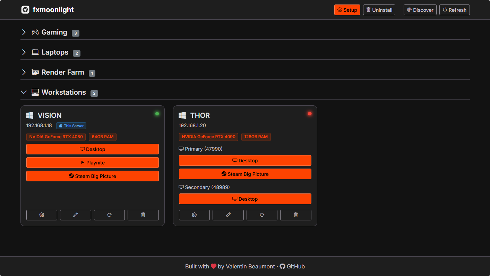
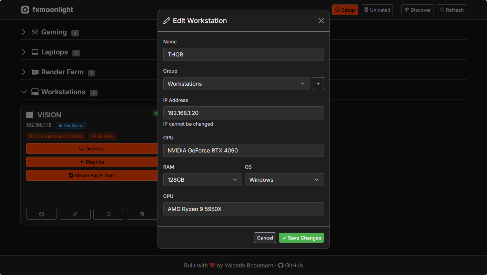
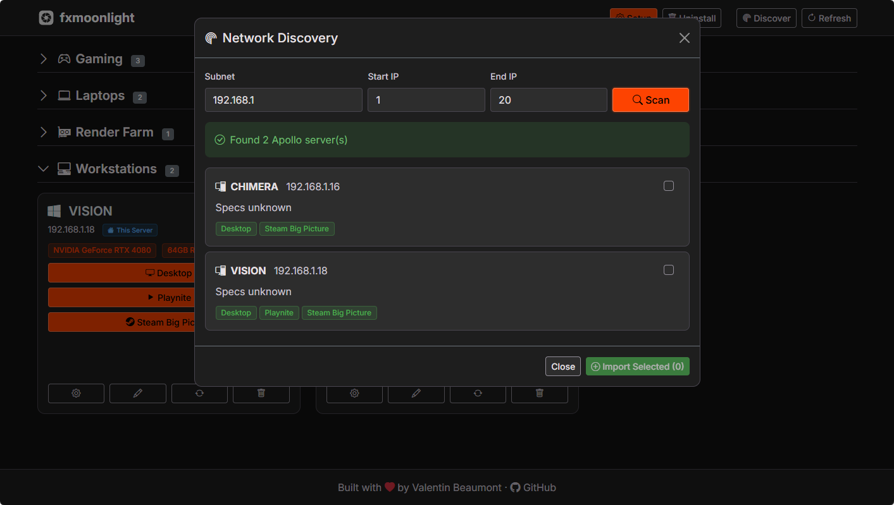

<div align="center">

  <picture>
    <source media="(prefers-color-scheme: dark)" srcset="https://raw.githubusercontent.com/healkeiser/fxmoonlight/main/images/fxmoonlight_logo_background_light.svg" width="100" height="100">
    <source media="(prefers-color-scheme: light)" srcset="https://raw.githubusercontent.com/healkeiser/fxmoonlight/main/images/fxmoonlight_logo_background_dark.svg" width="100" height="100">
    
  </picture>

  <h3 align="center">fxmoonlight</h3>

  <p align="center">
    A workstation manager dashboard for <a href="https://github.com/ClassicOldSong/Apollo">Apollo</a>/<a href="https://github.com/LizardByte/Sunshine">Sunshine</a> and <a href="https://moonlight-stream.org/">Moonlight</a> game streaming.
    <br/><br/>
    <a href="https://healkeiser.github.io/fxmoonlight"><strong>Documentation</strong></a>
  </p>

  ##

  <p align="center">
    <!-- Maintenance status -->
     &nbsp;&nbsp;
    <!-- &nbsp;&nbsp; -->
    <!-- License -->
     &nbsp;&nbsp;
    <!-- Last Commit -->
     &nbsp;&nbsp;
    <!-- Commit Activity -->
    <a href="https://github.com/healkeiser/fxmoonlight/pulse" alt="Activity"></a> &nbsp;&nbsp;
    <!-- GitHub stars -->
     &nbsp;&nbsp;
  </p>

</div>

## Table of Contents

- [Table of Contents](#table-of-contents)
- [About](#about)
- [Features](#features)
- [Requirements](#requirements)
- [Installation](#installation)
- [Client Setup](#client-setup)
- [Usage](#usage)
- [Project Structure](#project-structure)
- [Protocol Handler](#protocol-handler)
- [Configuration](#configuration)
- [Troubleshooting](#troubleshooting)
- [License](#license)
- [Contact](#contact)

## About

A workstation manager dashboard for [Apollo](https://github.com/ClassicOldSong/Apollo)/[Sunshine](https://github.com/LizardByte/Sunshine) and [Moonlight](https://moonlight-stream.org/) game streaming.





## Features

- **Auto-Discovery**: Scan your network for Apollo/Sunshine servers (supports multiple ports)
- **Hardware Detection**: Automatically retrieve GPU, CPU, RAM, and OS info via WMI/WinRM
- **App Detection**: Fetch available apps from Apollo servers
- **One-Click Streaming**: Launch Moonlight streams directly from the dashboard
- **Workstation Groups**: Organize machines into collapsible groups with custom icons
- **Icon Picker**: Visual icon selector for group customization
- **Edit Workstations**: Manually update machine specs and metadata
- **Customizable Theme**: Configure site name, icon, and accent colors (auto-adjusting text contrast)
- **Windows Service**: Run as a background service with automatic startup
- **Docker Support**: Run in containers on Linux or Windows

## Requirements

### Server (where the dashboard runs)
- **Windows 10/11 or Windows Server**
- **Python 3.10+**
- Network access to workstations on port 47990 (Apollo) and 5985 (WinRM)

### Client (where you access the dashboard)
- **Web browser**
- **Moonlight Client** installed at `C:\Program Files\Moonlight Game Streaming\Moonlight.exe`
- Protocol handler registered (download from Setup in dashboard)

## Installation

### Quick Start (Development)

1. **Clone the repository**
   ```powershell
   git clone https://github.com/healkeiser/fxmoonlight.git
   cd fxmoonlight
   ```

2. **Create virtual environment and install dependencies**
   ```powershell
   python -m venv .venv
   .\.venv\Scripts\Activate.ps1
   pip install -r requirements.txt
   ```

3. **Configure credentials** (optional, for remote WinRM/Apollo access)
   ```powershell
   Copy-Item config.example.json config.json
   # Edit config.json with your credentials
   ```

4. **Start the server**
   ```powershell
   python app.py
   ```

   The dashboard will be available at `http://localhost:5000`

### Production (Windows Service)

1. **Install NSSM** (Non-Sucking Service Manager)
   ```powershell
   # Using Chocolatey
   choco install nssm

   # Or Scoop
   scoop install nssm
   ```

2. **Run the install script** (as Administrator)
   ```powershell
   .\scripts\Install-MoonlightDashboardService.ps1
   ```

3. The service will start automatically and run on boot.

**Service management:**
```powershell
nssm stop MoonlightDashboard      # Stop
nssm start MoonlightDashboard     # Start
nssm restart MoonlightDashboard   # Restart
nssm edit MoonlightDashboard      # Edit configuration
```

To uninstall:
```powershell
.\scripts\Uninstall-MoonlightDashboardService.ps1
```

### Docker

Run the dashboard in a container (Linux or Windows with Docker Desktop):

1. **Using Docker Compose** (recommended)
   ```bash
   # Create data directory for persistence
   mkdir data

   # Copy and configure
   cp config.example.json data/config.json
   # Edit data/config.json with your settings

   # Start the container
   docker compose up -d
   ```

2. **Using Docker directly**
   ```bash
   # Build the image
   docker build -t fxmoonlight .

   # Run the container
   docker run -d \
     --name fxmoonlight \
     -p 5000:5000 \
     -v $(pwd)/data:/data \
     -e WINRM_PASSWORD=your-password \
     -e APOLLO_PASSWORD=your-password \
     fxmoonlight
   ```

The dashboard will be available at `http://localhost:5000`

> [!IMPORTANT]
> When running in Docker (Linux), local hardware detection via WMI is not available. Remote workstation detection via [WinRM](#enabling-winrm-on-workstations) still works. You can manually edit workstation specs using the dashboard.

## Client Setup

1. Open the dashboard in your browser
2. Click **Setup** in the navbar (orange button)
3. Download and run the `.reg` file to register the protocol handler
4. Test with the **Test Protocol Handler** button

### Pairing Moonlight Clients

Each device running Moonlight must be paired with the host PC:

1. Open **Moonlight** on your client device (phone, tablet, PC, etc.)
2. Your host PC should appear automatically. Tap/click on it.
3. Moonlight will display a **4-digit PIN**
4. Open the **Apollo/Sunshine Web UI** on your host PC (gear icon on workstation cards)
5. Go to **PIN** tab and enter the code
6. The client is now paired and can stream from that host

## Usage

### Workstation Cards

Each workstation card displays:
- **Name and IP**: Machine identifier with "This Server" badge if running the dashboard
- **Status indicator**: Green (online) or red (offline)
- **Hardware specs**: GPU, RAM badges
- **App buttons**: Launch Moonlight streams for each detected app

### Card Actions

| Button | Action |
|--------|--------|
| Gear | Open Apollo/Sunshine Web UI |
| Pencil | Edit workstation (name, group, specs) |
| Refresh | Probe for updated info from Apollo |
| Trash | Delete workstation |

### Groups

Organize workstations by assigning them to groups:

1. Click the **pencil** button on a workstation card
2. Select an existing group or create a new one (with custom icon)
3. Save changes

**Group features:**
- Collapsible headers with workstation counts
- Custom icons via the visual icon picker
- Click the pencil icon on group headers to change icons
- Groups are automatically sorted and displayed with their icons

## Project Structure

```
fxmoonlight/
├── app.py                   # Flask backend
├── requirements.txt         # Python dependencies
├── requirements-docker.txt  # Docker-compatible dependencies (no WMI)
├── Dockerfile               # Docker image definition
├── docker-compose.yml       # Docker Compose configuration
├── config.example.json      # Configuration template (copy to config.json)
├── config.json              # Your config with credentials (gitignored)
├── data.json                # Workstations and groups data (gitignored)
├── templates/
│   ├── index.html           # Main page layout
│   └── components/          # Reusable UI components
│       ├── workstation-card.html   # Workstation card
│       ├── modal-setup.html        # Setup/pairing instructions
│       ├── modal-uninstall.html    # Uninstall instructions
│       ├── modal-discover.html     # Network discovery
│       ├── modal-edit.html         # Edit workstation
│       ├── modal-confirm.html      # Confirmation dialogs
│       └── icon-picker.html        # Icon picker for groups
├── static/
│   ├── icon.svg             # App icon (customizable)
│   ├── css/
│   │   └── main.css         # All styles (uses CSS variables for theming)
│   └── js/
│       └── app.js           # All JavaScript (API, discovery, forms)
└── scripts/
    ├── Install-MoonlightDashboardService.ps1   # Install as Windows Service
    ├── Uninstall-MoonlightDashboardService.ps1 # Remove Windows Service
    └── Register-MoonlightProtocolHandler.ps1   # Alternative client setup (PowerShell)
```

## Protocol Handler

The `moonlight://` protocol handler allows launching streams from browser links:

```
moonlight://connect/{ip}?app={appname}
```

**Examples:**
- `moonlight://connect/192.168.1.10?app=Desktop`
- `moonlight://connect/192.168.1.10?app=Steam%20Big%20Picture`

The handler is registered directly in the Windows registry with embedded logic - no external script files are required after registration.

## Configuration

### config.json

Copy `config.example.json` to `config.json` and configure:

```json
{
  "site": {
    "name": "fxmoonlight",
    "icon": "/static/icon.svg",
    "accent_color": "#fd4301",
    "accent_color_hover": "#e63d00"
  },
  "credentials": {
    "winrm_user": "${WINRM_USER:-Administrator}",
    "winrm_password": "${WINRM_PASSWORD}",
    "apollo_user": "${APOLLO_USER}",
    "apollo_password": "${APOLLO_PASSWORD}"
  },
  "network": {
    "subnet": "192.168.1",
    "scan_start": 1,
    "scan_end": 254
  },
  "server_port": 5000,
  "apollo_ports": [47990, 48989, 47980, 46990],
  "scan_timeout": 1
}
```

| Field | Purpose |
|-------|--------|
| `site.name` | Dashboard title shown in navbar and browser tab |
| `site.icon` | Path to favicon/logo (SVG recommended) |
| `site.accent_color` | Primary accent color (hex) |
| `site.accent_color_hover` | Hover state accent color (hex) |
| `winrm_user/password` | Query remote Windows machines for hardware specs via WinRM |
| `apollo_user/password` | Apollo/Sunshine web UI credentials for API access |
| `network.*` | Default subnet and range for discovery scans |
| `server_port` | Dashboard server port (default: 5000) |
| `apollo_ports` | Apollo/Sunshine API ports to scan (array, tries each in order) |
| `scan_timeout` | Socket timeout in seconds for network scans (default: 1) |

### Apollo Authentication

The dashboard uses session-based authentication with Apollo/Sunshine. Configure your Apollo username and password in `config.json`:

```json
"credentials": {
  "apollo_user": "your_username",
  "apollo_password": "your_password"
}
```

> **Note:** All Apollo servers must share the same username/password for authentication to work across all machines.

### Environment Variables

For security, **passwords can be stored in environment variables** instead of the config file. Use the `${VAR}` syntax in config.json:

| Syntax | Behavior |
|--------|----------|
| `${VAR}` | Replaced with env var value (empty string if not set) |
| `${VAR:-default}` | Use env var value, or `default` if not set |

**Available environment variables:**

| Variable | Purpose |
|----------|---------|
| `WINRM_USER` | WinRM username for remote hardware detection |
| `WINRM_PASSWORD` | WinRM password |
| `APOLLO_USER` | Apollo/Sunshine web UI username |
| `APOLLO_PASSWORD` | Apollo/Sunshine web UI password |
| `FXMOONLIGHT_SECRET_KEY` | Flask session signing key (optional, auto-generated if not set) |
| `FXMOONLIGHT_CONFIG_FILE` | Path to config.json (default: `config.json`) |
| `FXMOONLIGHT_DATA_FILE` | Path to data.json (default: `data.json`) |

**Setting environment variables (PowerShell):**

```powershell
# Session only (for testing)
$env:WINRM_PASSWORD = "your-password"
$env:APOLLO_PASSWORD = "your-password"

# Persistent (user level)
[Environment]::SetEnvironmentVariable("WINRM_PASSWORD", "your-password", "User")
[Environment]::SetEnvironmentVariable("APOLLO_PASSWORD", "your-password", "User")

# Persistent (machine level, requires Admin)
[Environment]::SetEnvironmentVariable("WINRM_PASSWORD", "your-password", "Machine")
```

**For Windows Service (NSSM):**

```powershell
nssm set MoonlightDashboard AppEnvironmentExtra WINRM_PASSWORD=your-password APOLLO_PASSWORD=your-password
nssm restart MoonlightDashboard
```

### Enabling WinRM on Workstations

For remote hardware detection to work, enable WinRM on each workstation:

```powershell
# Run as Administrator on each workstation
Enable-PSRemoting -Force
Set-Item WSMan:\localhost\Client\TrustedHosts -Value "*" -Force
```

### Entra ID / Intune Environments

If your machines are managed by **Entra ID (Azure AD)** and **Intune**, you can deploy WinRM configuration across all workstations:

1. **Enable WinRM via Intune** - Push a PowerShell script through Intune:
   ```powershell
   Enable-PSRemoting -Force -SkipNetworkProfileCheck
   ```

2. **Configure firewall** - Push a firewall rule allowing port 5985 (WinRM HTTP)

3. **Shared admin account** - Use a local admin account deployed via Intune device configuration, or an Entra ID account with local admin rights on all machines

4. **Credential format in config.json**:
   ```json
   "credentials": {
     "winrm_user": "LocalAdminName",
     "winrm_password": "${WINRM_PASSWORD}"
   }
   ```
   Or for Entra ID accounts:
   ```json
   "winrm_user": "user@yourdomain.onmicrosoft.com"
   ```

> **Note:** For pure Entra ID joined machines (no hybrid AD), you may need to use a local admin account rather than cloud identities, as WinRM authentication with Entra-only accounts can require additional configuration.

### Moonlight Path

If Moonlight is installed in a non-standard location, the path is embedded in the `.reg` file downloaded from the dashboard. You'll need to:

1. Download the `.reg` file from Setup
2. Open it in a text editor
3. Change `C:\\Program Files\\Moonlight Game Streaming\\Moonlight.exe` to your path
4. Run the modified `.reg` file

## Troubleshooting

### "Moonlight not launching from browser"
- Ensure you've downloaded and run the `.reg` file from Setup
- Check that Moonlight is installed at `C:\Program Files\Moonlight Game Streaming\Moonlight.exe`
- Try the URL directly: `moonlight://connect/YOUR_IP?app=Desktop`

### "Discovery not finding machines"
- Ensure Apollo/Sunshine is running (default ports: 47990, 48989, 47980, 46990)
- Check firewall rules allow traffic on the Apollo ports
- Verify the target machines are on the expected subnet
- Try increasing `scan_timeout` in config.json for slower networks
- Check that `apollo_ports` in config.json includes the port your servers use

### "Hardware info incorrect or missing"
- Local machine: Uses WMI directly (most accurate)
- Remote machines: Requires WinRM credentials configured in config.json
- If WinRM fails, only hostname from DNS is shown
- You can manually edit workstation specs using the pencil button

### "Apps not detected"
- Ensure Apollo credentials are configured in config.json
- All Apollo servers must use the same username/password
- Click the refresh button on the workstation card to re-probe

## License

MIT License

## Contact

Project Link: [fxmoonlight](https://github.com/healkeiser/fxmoonlight)

<p align='center'>
  <!-- GitHub profile -->
  <a href="https://github.com/healkeiser">
    </a>&nbsp;&nbsp;
  <!-- LinkedIn -->
  <a href="https://www.linkedin.com/in/valentin-beaumont">
    </a>&nbsp;&nbsp;
  <!-- Behance -->
  <a href="https://www.behance.net/el1ven">
    </a>&nbsp;&nbsp;
  <!-- X -->
  <a href="https://twitter.com/valentinbeaumon">
    </a>&nbsp;&nbsp;
  <!-- Instagram -->
  <a href="https://www.instagram.com/val.beaumontart">
    </a>&nbsp;&nbsp;
  <!-- Gumroad -->
  <a href="https://healkeiser.gumroad.com/subscribe">
    </a>&nbsp;&nbsp;
  <!-- Gmail -->
  <a href="mailto:valentin.onze@gmail.com">
    </a>&nbsp;&nbsp;
  <!-- Buy me a coffee -->
  <a href="https://www.buymeacoffee.com/healkeiser">
    </a>&nbsp;&nbsp;
</p>
